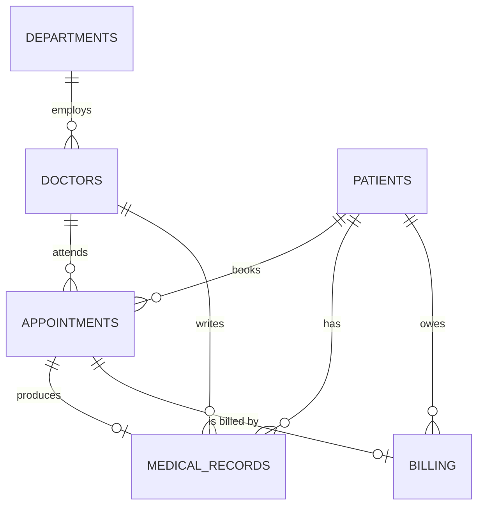

# Assignment IV – Records and Collections in Oracle PL/SQL
## Hospital Records Management System

| | |
|---|---|
| **Course** | Database Programming – Oracle PL/SQL |
| **Group members** | Student 1: `SAYINZOGA Reine Esther KEZA` (`20251SEN227`) · Student 2: `UMUTONIWASE NIZEYIMANA QUEEN` (`29394`) |
| **Scenario** | Hospital records |
| **Database** | Oracle 12c or later (uses only standard PL/SQL; no packages needed) |

---

## 1. Application description and requirements

A small hospital keeps its patients, doctors and visits in an Oracle database. The PL/SQL layer
(procedures and functions only) must let staff:

| # | Requirement | Implemented by |
|---|---|---|
| R1 | Register patients with validated data and unique phone numbers | `register_patient` |
| R2 | Book appointments only with existing, ACTIVE doctors, in the future, without double-booking | `book_appointment`, `is_doctor_available` |
| R3 | Move an appointment from SCHEDULED to COMPLETED / CANCELLED | `update_appointment_status` |
| R4 | Complete a visit: save diagnosis, close the appointment and bill the patient (20 % discount when insured) | `add_medical_record`, `calculate_bill_amount` |
| R5 | Show a patient's full medical history and outstanding balance | `print_patient_history`, `get_patient_balance` |
| R6 | Report workload per doctor in a department | `doctor_workload_report` |
| R7 | Change doctor fees for a whole department efficiently | `bulk_update_doctor_fees` |
| R8 | Generate all missing bills at once | `bulk_generate_bills` |
| R9 | Remove old cancelled appointments | `purge_cancelled_appointments` |
| R10 | Show why bulk processing is faster than row-by-row | `benchmark_bulk_vs_row` |
| R11 | Log unexpected errors without losing them on rollback | `log_error` |

### Database design (ER overview)



Tables: `departments`, `doctors`, `patients`, `appointments`, `medical_records`, `billing`,
plus helper tables `error_log` and `perf_demo`. Full constraints (PK, FK, UNIQUE, CHECK, NOT NULL,
a function-based unique index preventing double-booking) are in `00_schema/01_create_tables.sql`.

---

## 2. Concept coverage (where to find each requirement)

| Assignment requirement | Where it is demonstrated |
|---|---|
| **Records** – user-defined | `register_patient` (`t_new_patient`), `add_medical_record` (`t_visit`), `bulk_generate_bills` (`t_bill_rec`) |
| **Records** – `%ROWTYPE` | `book_appointment`, `get_patient_row` (returns `patients%ROWTYPE`), `print_patient_history` (`c_history%ROWTYPE`) |
| **Collections** – associative array | `doctor_workload_report` (`INDEX BY VARCHAR2`), `benchmark_bulk_vs_row` |
| **Collections** – nested table | `bulk_update_doctor_fees`, `bulk_generate_bills`, schema type `t_num_tab` returned by `get_patient_record_ids` |
| **Collections** – VARRAY | `update_appointment_status` (list of valid statuses) |
| **Implicit cursors** | INSERT: `register_patient` · UPDATE: `update_appointment_status` · DELETE: `purge_cancelled_appointments` (`SQL%ROWCOUNT`, `SQL%FOUND`, `SQL%NOTFOUND`) |
| **Explicit cursors** | `OPEN/FETCH/CLOSE` with parameter: `print_patient_history` · cursor `FOR` loop: `doctor_workload_report` · cursor + `LIMIT`: `bulk_update_doctor_fees` |
| **BULK COLLECT** | `bulk_generate_bills`, `bulk_update_doctor_fees` (with `LIMIT`), `get_patient_record_ids` |
| **FORALL** | `bulk_generate_bills` (INSERT), `bulk_update_doctor_fees` (UPDATE), `benchmark_bulk_vs_row` (INSERT) |
| **Bulk DML errors** | `SAVE EXCEPTIONS`, `SQL%BULK_EXCEPTIONS`, `ORA-24381` via `EXCEPTION_INIT` |
| **Stored procedures** | 11 procedures in `01_procedures/` with IN / OUT parameters |
| **Functions** | 7 functions in `02_functions/`, called from SQL and from PL/SQL (see tests S1, S2) |
| **Predefined exceptions** | `NO_DATA_FOUND`, `TOO_MANY_ROWS` (`get_patient_id_by_name`), `DUP_VAL_ON_INDEX`, `ORA-02292` |
| **User-defined exceptions + `RAISE_APPLICATION_ERROR`** | every procedure / function (see error-code table below) |
| **No hidden errors** | unexpected errors are logged by `log_error` and **re-raised**; there is no `WHEN OTHERS THEN NULL` anywhere |

---

## 3. How to run

Requirements: an Oracle schema where you may create tables, sequences, types and PL/SQL objects,
and SQL*Plus or SQLcl. Run everything from the **repository root**.

**One command**

```
sqlplus <user>/<password>@<service> @run_all.sql
```

**Or step by step (same order as `run_all.sql`)**

1. `00_schema/01_create_tables.sql` – tables, sequences (re-runnable: drops first)
2. `00_schema/02_insert_sample_data.sql` – sample data
3. `00_schema/03_create_types.sql` – nested-table type `t_num_tab`
4. all files in `02_functions/` (functions are compiled **before** procedures that call them)
5. `01_procedures/log_error.sql` first, then the other files in `01_procedures/`
6. `03_tests/test_success_cases.sql`, then `03_tests/test_error_cases.sql`
7. Take screenshots of each test section into `screenshots/` (e.g. `S5_add_medical_record_output.png`)

After compiling, `SELECT * FROM user_errors;` must return no rows.

> **Transactions:** procedures never `COMMIT`; the caller decides. The success test ends with
> `ROLLBACK`, so the sample data is unchanged and the tests are repeatable.

---

## 4. Application error codes

| Code | Meaning | Code | Meaning |
|---|---|---|---|
| -20010 / -20011 | `calculate_age`: DOB missing / in future | -20401 / -20402 / -20403 | `add_medical_record`: no diagnosis / not SCHEDULED / not found |
| -20020 | `get_patient_balance`: patient unknown | -20501 / -20502 | `purge_cancelled_appointments`: bad days / still referenced |
| -20030 | `calculate_bill_amount`: appointment unknown | -20701 | `doctor_workload_report`: department unknown |
| -20040 / -20041 | `get_patient_id_by_name`: none / ambiguous | -20801 / -20802 | `bulk_update_doctor_fees`: bad percentage / dept unknown |
| -20050 | `get_patient_row`: patient unknown | -20950 | `benchmark_bulk_vs_row`: bad row count |
| -20060 | `get_patient_record_ids`: patient unknown | -20101 / -20102 | `register_patient`: invalid input / duplicate phone |
| -20070 | `is_doctor_available`: doctor unknown | -20201 … -20206 | `book_appointment` (see file header) |
| -20301 / -20302 | `update_appointment_status`: bad status / not updatable | | |

---

## 5. Repository layout

```
plsql-assignment4-<studentID1>-<studentID2>/
├── README.md
├── run_all.sql                    # builds + tests everything in order
├── .gitignore
├── 00_schema/   01_create_tables.sql · 02_insert_sample_data.sql · 03_create_types.sql
├── 01_procedures/   (one file per procedure)
├── 02_functions/    (one file per function)
├── 03_tests/    test_success_cases.sql · test_error_cases.sql
├── screenshots/     (add your own outputs here)
└── docs/IMPLEMENTATION_NOTES.md
```

See `docs/IMPLEMENTATION_NOTES.md` for the design explanation and the bulk-processing performance discussion.
